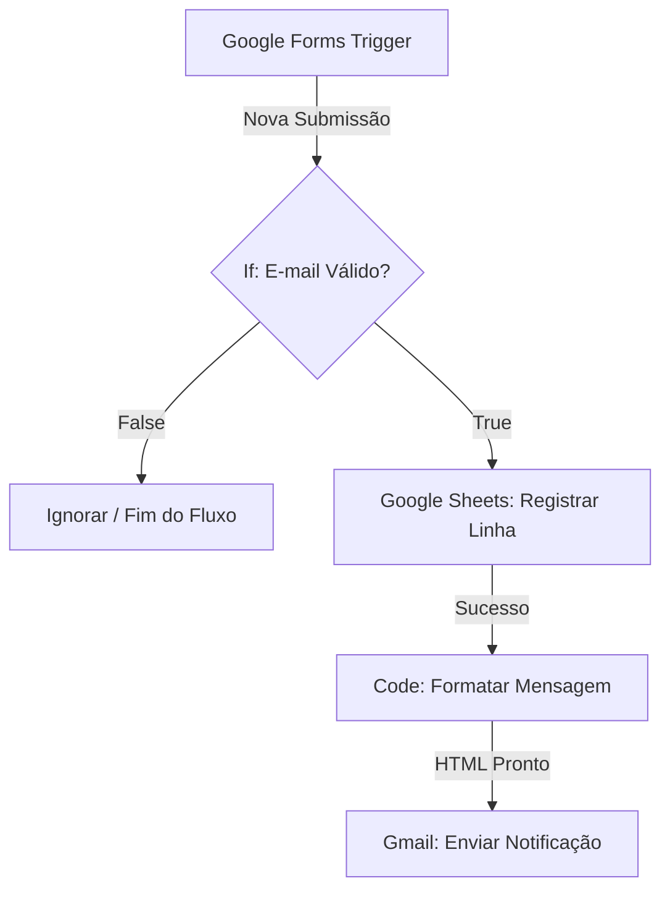

# Automatização de Inscrições em Treinamentos Corporativos com n8n

[](https://n8n.io/)
[](https://workspace.google.com/)
[](https://workspace.google.com/)

Este repositório contém a documentação e a estrutura de um fluxo de automação desenvolvido no **n8n** para otimizar e centralizar o processo de inscrição de colaboradores em treinamentos corporativos. 

A solução foi pensada especificamente para equipes de **Recursos Humanos (RH)** e **Desenvolvimento Organizacional (DO)**, garantindo agilidade, validação de dados e comunicação em tempo real.

---

## 🎯 Objetivo do Projeto

Eliminar processos manuais e planilhas descentralizadas, automatizando:
1. A captura de novas inscrições feitas via formulários online.
2. A validação estrita de dados (bloqueio de e-mails inválidos ou vazios).
3. O registro imediato em uma planilha centralizada de controle.
4. O envio de alertas automáticos formatados para o canal de e-mail interno da equipe de RH/DO.

---

## 🛠️ Ferramentas Envolvidas

* **Google Forms:** Interface amigável para submissão das inscrições pelos colaboradores.
* **n8n:** Motor de automação de fluxo de trabalho (Workflow Automation Engine).
* **Google Sheets:** Banco de dados relacional simples para controle e histórico das turmas.
* **Gmail:** Canal de disparo de notificações internas para os responsáveis.

---

## 📐 Arquitetura do Workflow (Passo a Passo)

O fluxo é composto por 5 nós integrados sequencialmente:



### 1. Nó Gatilho: `Google Forms Trigger`
* **Função:** Fica em escuta ativa aguardando o envio de um novo formulário de inscrição.
* **Payload Capturado:** Nome Completo, E-mail, Departamento, Treinamento Escolhido e Data/Hora.

### 2. Nó de Decisão: `If`
* **Função:** Implementa a regra de negócio de **ignorar registros sem e-mail válido**.
* **Lógica:** Valida se o campo de e-mail possui uma estrutura correta (contendo `@` e domínio válido) por meio de expressões regulares. Caso seja inválido, o fluxo é interrompido com segurança.

### 3. Nó de Integração: `Google Sheets` (Append Row)
* **Função:** Insere os dados validados diretamente na planilha corporativa de controle de treinamentos.
* **Mapeamento:** Preenche automaticamente as colunas correspondentes de participante, departamento e curso escolhido.

### 4. Nó de Manipulação de Dados: `Code` (JavaScript)
* **Função:** Extrai as informações e constrói um template HTML limpo e responsivo para a notificação interna.
* **Exemplo de Script utilizado:**
  ```javascript
  const item = $input.item.json;
  return {
    json: {
      assunto: `[Nova Inscrição] ${item['Treinamento Escolhido']} - ${item['Nome Completo']}`,
      corpoHtml: `
        <h3>Nova Inscrição Registrada com Sucesso</h3>
        <p><strong>Participante:</strong> ${item['Nome Completo']}</p>
        <p><strong>E-mail:</strong> ${item['Email']}</p>
        <p><strong>Departamento:</strong> ${item['Departamento']}</p>
        <p><strong>Treinamento:</strong> ${item['Treinamento Escolhido']}</p>
      `
    }
  };
  ```

### 5. Nó de Envio: `Gmail` (Send)
* **Função:** Envia o e-mail formatado em HTML diretamente para o canal ou lista de distribuição interna da equipe de Recursos Humanos / Desenvolvimento Organizacional (`rh-treinamentos@suaempresa.com`).

---

## 🚀 Como Configurar e Instalar

1. **Pré-requisitos:**
   * Uma instância do n8n ativa (Cloud ou Self-hosted).
   * Contas do Google Workspace integradas via credenciais OAuth2 no n8n (para Google Forms, Sheets e Gmail).

2. **Importação do Workflow:**
   * Crie um novo workflow em branco no seu painel do n8n.
   * Copie o código JSON do workflow (se disponível na pasta do projeto) ou recrie os nós seguindo a arquitetura descrita acima.

3. **Mapeamento de Credenciais:**
   * Vincule sua conta do Google ao nó `Google Forms Trigger` e `Google Sheets`.
   * Configure suas credenciais de e-mail no nó `Gmail`.

4. **Ativação:**
   * Realize um teste unitário preenchendo o formulário de homologação.
   * Alterne o status do workflow no canto superior direito de **Inactive** para **Active**.

---

## 💡 Boas Práticas Implementadas
* **Tratamento de Exceções:** Configuração recomendada de rotas de erro (`Error Trigger`) para monitorar falhas de API no Google Sheets ou Gmail.
* **Sanitização de Dados:** O uso do nó `If` impede a poluição da planilha de controle com envios vazios ou e-mails digitados incorretamente.

---
Desenvolvido com o apoio de automação inteligente no n8n.